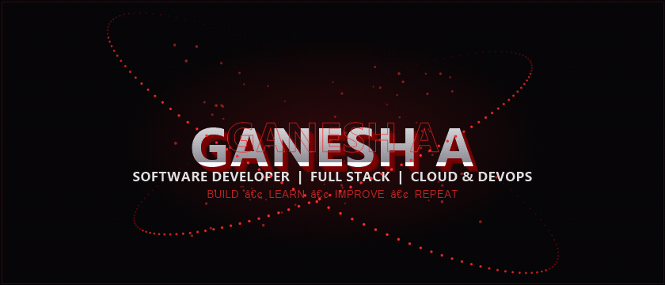
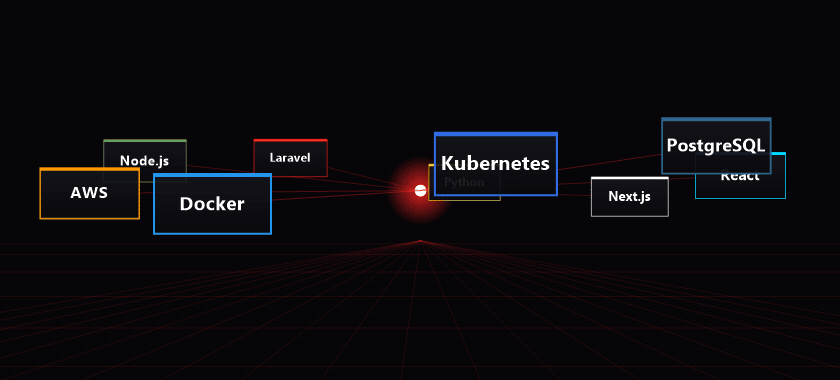
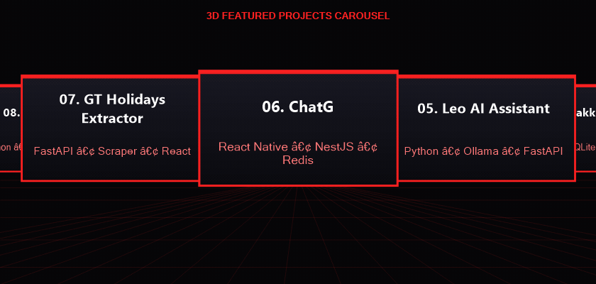
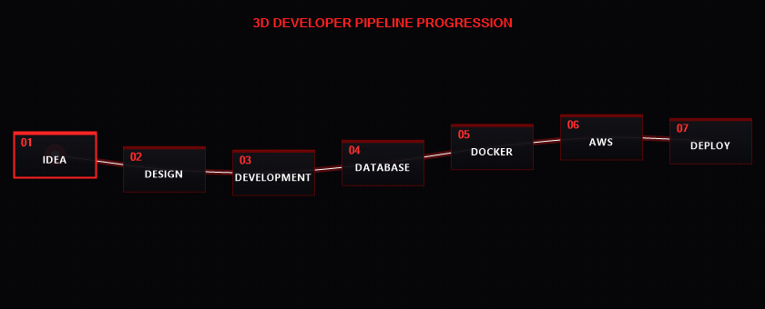
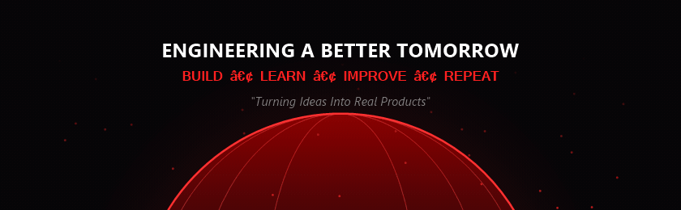

<div align="center">



<br/><br/>


<br/><br/>

<a href="https://www.ganeshdeveloper.in/">
  
</a>
<a href="https://www.linkedin.com/in/ganesh-software-developer/">
  
</a>
<a href="https://github.com/GANESHAATHI46">
  
</a>


<br/><br/>


</div>

## 02 / About Me

<div align="center">
  
</div>

<br/>

I'm **Ganesh A**, a Software Developer from Tamil Nadu, India.

I enjoy building modern web applications, mobile applications, backend APIs, automation systems, and cloud-ready software.

My approach goes beyond writing code. I focus on understanding the complete software development lifecycle — from an initial idea to deployment and continuous improvement.

```yaml
developer:
  name: Ganesh A
  username: GANESHAATHI46
  role: Software Developer
  location: Tamil Nadu, India
  engineering:
    - Full Stack Development
    - Frontend Engineering
    - Backend APIs
    - Mobile Applications
    - Automation
    - SaaS Products
    - Cloud Engineering
    - DevOps
  currently_exploring:
    - AWS
    - Docker
    - Kubernetes
    - Terraform
    - Jenkins
    - DevSecOps
    - System Design
  philosophy: "Build useful software. Make it reliable. Keep improving."
```

<div align="center">
  
</div>

## 03 / 3D Technology Universe

<div align="center">
  
</div>

<br/>

<div align="center">

<p><strong>FRONTEND ENGINEERING</strong></p>


<br/><br/>

<p><strong>BACKEND ENGINEERING</strong></p>


<br/><br/>

<p><strong>DATABASES &amp; CACHING</strong></p>


<br/><br/>

<p><strong>CLOUD &amp; DEVOPS</strong></p>


<br/><br/>

<p><strong>DEVELOPMENT TOOLS</strong></p>


</div>

<div align="center">
  
</div>

## 04 / Engineering Capabilities

| Domain | Technologies &amp; Skills |
| :--- | :--- |
| **Frontend** | React, React Native, TypeScript, JavaScript, Vite, Tailwind CSS |
| **Backend** | Python, Django, DRF, FastAPI, Laravel, Node.js |
| **Database** | PostgreSQL, MySQL, SQLite, Redis |
| **Mobile** | React Native, Expo, Offline-first applications |
| **Cloud** | AWS, Vercel, Cloudflare |
| **DevOps** | Docker, Kubernetes, Helm, Terraform, Jenkins |
| **CI/CD** | GitHub Actions, Deployment Automation |
| **API** | REST API, Swagger, OpenAPI, Postman |
| **Web Server** | Nginx |
| **Architecture** | SaaS, API-driven systems, Modular Backend Design |

<div align="center">
  
</div>

## 05 / 3D Featured Projects

<div align="center">
  
</div>

<br/>

<table>
<tr>

<td width="50%" valign="top">

### 01. Image Scraper Pro

A commercial-grade image scraping and processing platform designed for image discovery, filtering, optimization and download workflows.

#### Key Features
- Keyword-based image discovery
- Manual image selection
- Duplicate detection
- Smart crop and resize
- ZIP export
- Authentication and licensing
- Device binding
- Admin dashboard
- Cloud-ready backend

#### Stack
`React` `Python` `Flask` `FastAPI` `Docker` `Cloudflare`

</td>

<td width="50%" valign="top">

### 02. Focus Tourism Eventz

A tourism and events platform focused on responsive interfaces, performance, SEO and scalable backend architecture.

#### Key Features
- Responsive React interface
- Lazy loading
- Bundle optimization
- SEO improvements
- Backend API architecture
- PostgreSQL integration
- Cloud deployment planning

#### Stack
`React` `Vite` `Tailwind CSS` `Django` `PostgreSQL` `AWS`

<br/>

🌐 [Visit Project](https://www.focustourismeventz.com/)

</td>

</tr>

<tr>

<td width="50%" valign="top">

### 03. Mei Alai

A full-stack e-commerce platform with product management, customer workflows and administration tools.

#### Key Features
- Product management
- Customer workflows
- Admin dashboard
- API-driven architecture
- Swagger documentation
- Inventory management

#### Stack
`React` `Vite` `Laravel` `Filament` `MySQL`

</td>

<td width="50%" valign="top">

### 04. Namma Kanakku

An offline-first personal finance mobile application designed for daily money and expense management.

#### Key Features
- Daily, weekly and monthly reports
- Offline SQLite storage
- Tamil-focused interface
- PDF export
- Date-based transaction management

#### Stack
`React Native` `Expo` `TypeScript` `SQLite`

</td>

</tr>

<tr>

<td width="50%" valign="top">

### 05. Leo AI Assistant

A local-first desktop AI assistant designed to support developer workflows.

#### Key Features
- Ollama integration
- Local LLM support
- Tamil / Tanglish interaction
- Developer utilities
- Local command workflows
- FastAPI desktop companion
- Safe Markdown rendering

#### Stack
`Python` `FastAPI` `JavaScript` `Ollama`

</td>

<td width="50%" valign="top">

### 06. ChatG

A WhatsApp-inspired real-time messaging platform architecture designed with scalability in mind.

#### Key Features
- Real-time messaging
- WebSockets
- Authentication
- Redis caching
- PostgreSQL
- Media storage architecture
- Mobile-first experience

#### Stack
`React Native` `NestJS` `PostgreSQL` `Redis`

</td>

</tr>

<tr>

<td width="50%" valign="top">

### 07. GT Holidays Extractor

A tour package extraction and data-processing system for collecting structured travel information.

#### Key Features
- Generic scraper architecture
- Dynamic metadata extraction
- Price and currency detection
- CSV / Excel export
- Secure URL handling
- API and frontend workflow

#### Stack
`Python` `FastAPI` `HTTPX` `BeautifulSoup` `React` `TypeScript`

</td>

<td width="50%" valign="top">

### 08. Client Hunter

A lead-discovery and prospecting tool focused on business data extraction and scoring.

#### Key Features
- Location-based lead discovery
- Business scoring
- CSV export
- Excel export
- Search and filtering workflows

#### Stack
`Python` `Streamlit` `Pandas` `OpenPyXL`

</td>

</tr>

<tr>

<td width="50%" valign="top">

### 09. PaperCollect

A mobile application for marriage-function collection management and offline record keeping.

#### Key Features
- Offline-first workflow
- Tamil interface
- Bulk save
- OCR-assisted entry
- CSV / PDF export
- Local database

#### Stack
`React Native` `Expo` `TypeScript` `SQLite`

</td>

<td width="50%" valign="top">

### 10. Namma Ooru Quest

A Tamil Nadu-inspired Unity game project featuring district-based environments and local visual elements.

#### Key Features
- Stylized Tamil Nadu environment
- Runner gameplay
- NPC concepts
- Local village visual themes
- Temple and signage concepts
- Performance optimization planning

#### Stack
`Unity` `C#`

</td>

</tr>
</table>

<div align="center">
  
</div>

## 06 / Developer Journey

<div align="center">
  
</div>

<div align="center">
  
</div>

## 07 / Currently Learning

<div align="center">
  
</div>

<br/>

| Learning Path | Focus |
| :--- | :--- |
| **AWS** | Cloud infrastructure and architecture |
| **Docker** | Containerization |
| **Kubernetes** | Container orchestration |
| **Terraform** | Infrastructure as Code |
| **Jenkins** | CI/CD automation |
| **GitHub Actions** | Automated workflows |
| **DevSecOps** | Security integration |
| **System Design** | Scalable architecture |

<div align="center">
  
</div>

## 08 / GitHub Analytics

<div align="center">
  
  
  <br/><br/>
  
</div>

<div align="center">
  
</div>

## 09 / Contribution Snake

<div align="center">
  
</div>

<div align="center">
  
</div>

## 10 / Backend Engineering

I enjoy working with backend systems that include:

- REST API architecture &amp; modular services
- Authentication, authorization &amp; session tokens
- Role-based access control (RBAC)
- PostgreSQL schema modeling &amp; query optimization
- Redis caching &amp; high-performance memory stores
- Secure file storage &amp; image upload pipelines
- Comprehensive API documentation (Swagger / OpenAPI)
- Input data validation &amp; sanitization
- Structured error handling &amp; centralized logging
- API rate limiting &amp; security protections
- Production-ready containerization

<div align="center">
  
</div>

## 11 / Frontend Engineering

My frontend development approach focuses on:

- Responsive interfaces across mobile, tablet, and desktop
- Reusable, maintainable component systems
- Modern layouts using Tailwind CSS and CSS Grid / Flexbox
- Performance optimization &amp; bundle size efficiency
- Web accessibility (WCAG standards &amp; semantic tags)
- Type-safe API integrations
- Smooth loading skeletons &amp; error boundary handling
- Clean visual hierarchy &amp; typography
- High-fidelity production UI

<div align="center">
  
</div>

## 12 / Mobile Development

Cross-platform mobile development technologies and practices:

- React Native &amp; Expo ecosystems
- Type-safe application logic with TypeScript
- Offline-first SQLite local architecture
- Local data persistence &amp; state management
- Document generation (PDF &amp; CSV exports)
- Camera &amp; OCR-assisted document entries
- Tamil-focused localized user interfaces

<div align="center">
  
</div>

## 13 / Cloud & DevOps

<div align="center">
  
</div>

<br/>

```text
Source Code
    ↓
Git / GitHub
    ↓
Automated Testing
    ↓
Docker Image
    ↓
CI Pipeline
    ↓
Security Checks
    ↓
Deployment
    ↓
Cloud Infrastructure
    ↓
Monitoring
    ↓
Production
```

**Technologies I'm exploring:**

`Docker` &bull; `Kubernetes` &bull; `Helm` &bull; `Terraform` &bull; `Jenkins` &bull; `GitHub Actions` &bull; `AWS` &bull; `Nginx` &bull; `Linux`

<div align="center">
  
</div>

## 14 / Development Principles

```javascript
const engineeringPrinciples = [
  "Clean Architecture",
  "Maintainable Code",
  "Performance",
  "Security",
  "Scalability",
  "Automation",
  "Accessibility",
  "Real-world Usability",
  "Continuous Improvement"
];

const mindset = "Build → Learn → Improve → Repeat";
```

<div align="center">
  
</div>

## 15 / Goals & Vision

```text
Short-Term Goals
├── Strengthen Full Stack Development
├── Improve AWS cloud architecture knowledge
├── Master Docker containerization & Kubernetes orchestration
├── Learn Terraform infrastructure-as-code deeply
├── Build automated production CI/CD pipelines
└── Elevate distributed system design skills

Long-Term Goals
├── Build scalable SaaS products from zero to production
├── Become a distinguished Cloud & DevOps Engineer
├── Architect high-availability production systems
├── Lead and contribute to impactful open-source initiatives
└── Continuously engineer useful, reliable digital products
```

<div align="center">
  
</div>

## 16 / Open To Collaborations

- Full Stack Development
- Frontend Development (React, Next.js, Vite, Tailwind CSS)
- Backend Development (Python, FastAPI, Django, Laravel, Node.js)
- Mobile Applications (React Native, Expo)
- Cloud &amp; DevOps collaborations (AWS, Docker, CI/CD)
- SaaS Product Development &amp; Prototyping
- Open Source Developer Tools
- Web Scraping &amp; Automation Systems

<div align="center">
  
</div>

## 17 / Connect With Me

<div align="center">
  <a href="https://www.ganeshdeveloper.in/">
    
  </a>
  <a href="https://www.linkedin.com/in/ganesh-software-developer/">
    
  </a>
  <a href="https://github.com/GANESHAATHI46">
    
  </a>

  <br/><br/>

  
</div>

<div align="center">
  
</div>

## 18 / Cinematic 3D Footer

<div align="center">
  
</div>
